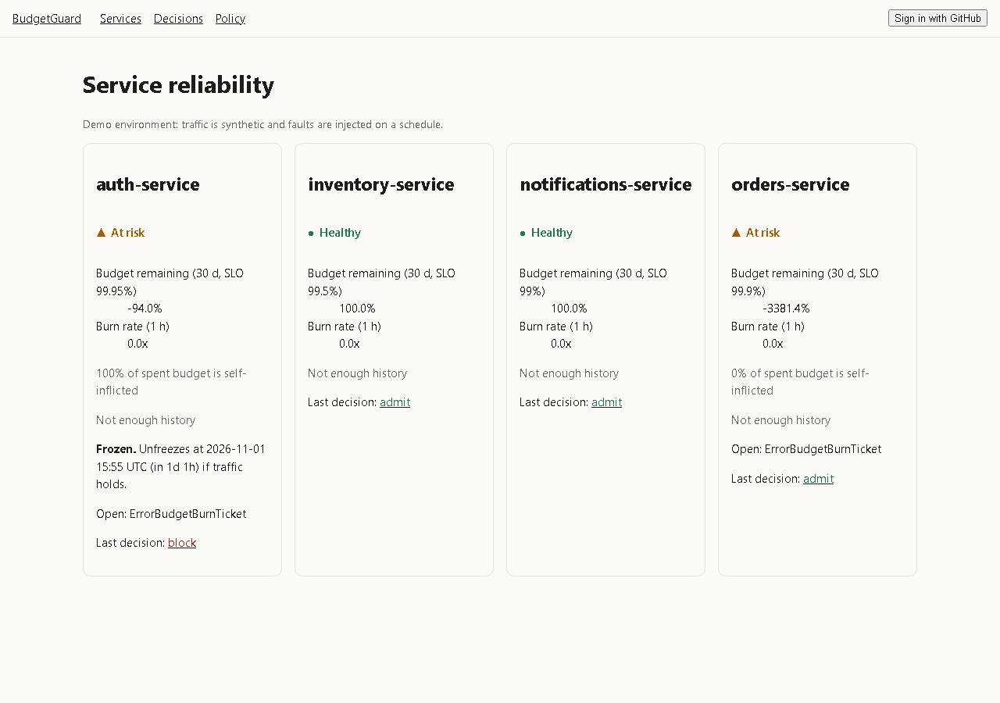
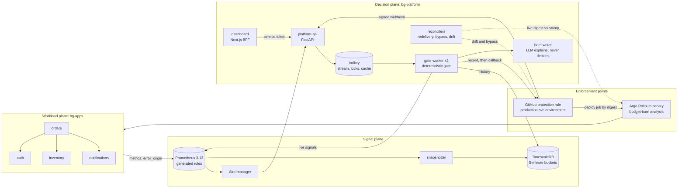
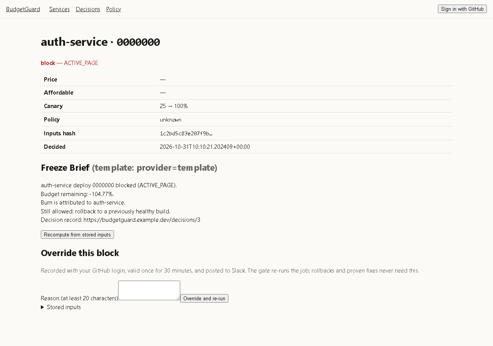
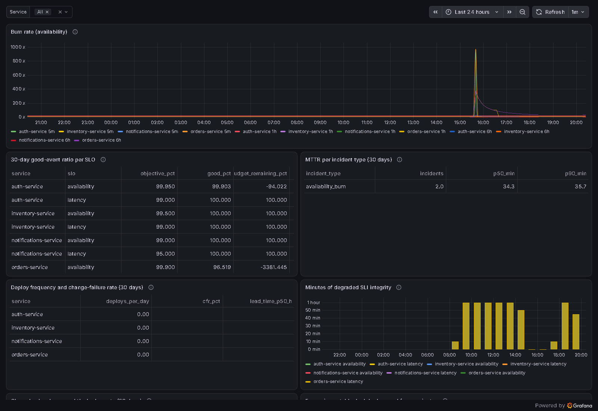
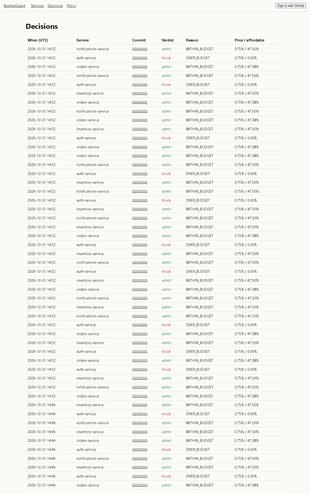

# BudgetGuard

**An error-budget admission controller.** Four Spring Boot services publish request-based SLIs.
Prometheus computes multi-window burn rates. A GitHub App sits on each production environment as
a custom deployment protection rule, so the gate cannot be deleted from a workflow file.

Instead of freezing at a flat 10%, BudgetGuard **prices each deploy**: its probability of failing,
from that service's own history and the change's risk, times what a failure usually costs. It
admits the deploy only if the remaining budget can afford it. Rollbacks are always admitted.
Proven fixes for the active incident pass. A frozen service gets an exact time its budget comes
back. A dead service never counts as healthy, and when auth breaks orders, auth pays. Policy
changes are backtested in CI before they merge, and every verdict can be recomputed from its
stored inputs.

> **Status (31 Oct 2026):** weeks 0–8 built and verified on the local stack (compose + k3s in
> Docker). The public deployment (Oracle ARM VM, Cloudflare Tunnel, the real GitHub App) and the
> 3-minute demo recording need the owner's accounts. See [Known limits](#known-limits).



## Contents

- [Architecture](#architecture)
- [What makes it different](#what-makes-it-different)
- [SLOs and the arithmetic](#slos-and-the-arithmetic)
- [Quick start (compose)](#quick-start-compose)
- [Kubernetes install](#kubernetes-install)
- [Decisions, with measured numbers](#decisions-with-measured-numbers)
- [Testing](#testing)
- [Screenshots](#screenshots)
- [Known limits](#known-limits)

## Architecture



| Plane | What it does | Where |
| --- | --- | --- |
| Workload | Emits truth: request counts, latency buckets, and `error_origin` (`self` or `dep:<service>`) on every 5xx. Decides nothing | `services/` (Spring Boot 4.1, Java 21) |
| Signal | One spec per service generates every recording rule, alert and promtool test. The snapshotter writes request-weighted 5-minute buckets | `slo/`, `rules/`, `platform/budgetguard/rulegen/`, `workers/snapshotter.py` |
| Decision | Gate chain: rollback → override → integrity → incident fix → hard stop → price. The decision is recorded before GitHub is answered | `platform/budgetguard/{gate,pricing,lanes,gather}.py`, `workers/gate_worker.py` |
| Enforcement | The GitHub protection rule pauses the job; `KUBECONFIG` exists only in that environment. The Rollout's analysis aborts on self-inflicted burn | `.github/workflows/deploy.yml`, `deploy/helm/service/` |

## What makes it different

| | Problem | Mechanism |
| --- | --- | --- |
| D-1 | A `curl` gate step can be deleted | The protection rule runs outside the YAML. Delete the `environment:` line and the job loses the cluster credentials. Bypass and drift reconcilers make any workaround visible |
| D-2 | A flat freeze threshold blocks a one-line fix and admits a 900-line migration | Beta(2,18)-Binomial failure probability × change-risk multipliers × median failure cost, admitted only within `k × (remaining − reserve)` |
| D-3 | The victim of a dependency outage gets frozen | `error_origin` on every 5xx. The gate prices against the self-only budget, and a page counts only when the service's own share is high |
| D-4 | A dead service has a perfect error rate | Signal integrity first (`absent`, `up == 0`, probe, traffic floor). Missing data is UNKNOWN, and the service's declared failure mode applies |
| D-5 | "Wait for the budget" is not an answer | The unfreeze ETA replays the stored buckets forward as the oldest bad minutes age out |
| D-6 | Pricing priors are guesses | Policy PRs are backtested on recorded and synthetic deploys. CI fails on a broken invariant or a regression of more than 2 pp |
| D-7 | A 5% canary on 4 replicas is really 25%, and internal calls bypass the ingress | Argo Rollouts with Traefik weighted routing, including service-to-service calls through an internal entrypoint. Steps scale with the remaining budget |
| D-8 | Trust, interop, audit | Every decision is replayable by hash. Sloth parity is proven in promtool, and OpenSLO ratio SLOs can be imported |

**Why not Sloth or Pyrra?** Both generate excellent SLO rules and dashboards. BudgetGuard's rules
match Sloth's to 1e-9 at every short window (`rules/parity/`). Neither decides whether a
particular deploy may ship, prices it, attributes burn to a culprit, or enforces outside the
workflow file. That is what BudgetGuard adds. One difference showed up while proving parity:
Sloth's 30-day ratio averages 5-minute ratios, so a quiet night weighs as much as a peak hour.
BudgetGuard sums requests.

## SLOs and the arithmetic

| Service | Objective | Bad requests allowed | Time-equivalent per 30 d |
| --- | --- | --- | --- |
| auth-service | 99.95% | 1 in 2,000 | 21.6 min |
| orders-service | 99.9% | 1 in 1,000 | 43.2 min |
| inventory-service | 99.5% | 1 in 200 | 3.6 h |
| notifications-service | 99.0% (delivered < 2 min) | 1 in 100 | 7.2 h |

| Tier | Long / short window | Burn | Budget spent in the long window |
| --- | --- | --- | --- |
| Page | 1 h / 5 m | 14.4x | 2% (at 14.4x a full budget lasts 50 h, not 1 h) |
| Page | 6 h / 30 m | 6x | 5% |
| Ticket | 3 d / 6 h | 1x | 10% |

Every alert also needs a traffic floor (`min_events_per_hour`). `SLIIntegrityLost` pages when
the signal disappears.

## Quick start (compose)

Container work runs in WSL 2 (`Ubuntu-D`) on this machine; any Linux with Docker works the same.

```bash
cd services && ./mvnw -q -DskipTests package && cd ..   # build the four service jars
make up                                                 # secrets (git-ignored), rules, the whole stack
make status                                             # HEALTHY / AT_RISK / UNKNOWN per SLO
make demo-fast-burn                                     # orders at 20x for 15 min: page, then priced blocks
make demo-dependency-outage                             # auth fails; auth is frozen, orders is not (D-3)
make demo-dead-service                                  # inventory stops: UNKNOWN, never HEALTHY (D-4)
```

| URL | What |
| --- | --- |
| http://localhost:3000 | Dashboard: cards, decisions with Recompute, overrides, policy versions |
| http://localhost:3001 | Grafana (anonymous, read-only): burn rates, 30-day ratios, MTTR, DORA, chargeback, freeze impact |
| http://localhost:9090 | Prometheus |

Drills against the running stack:

```bash
bash deploy/compose/chaos-drill.sh       # BudgetGuard's own failure modes (docs/runbooks/chaos-drill.md)
bash deploy/compose/rotation-drill.sh    # rotate the dashboard token with no failed request
bash load/bench-ab.sh 40 3               # merge storm: verdict latency, option A vs C
bash load/canary-share.sh                # D-7: the share a 5% step actually gets (k3s in Docker)
```

## Kubernetes install

1. A k3s VM (Oracle Cloud Always Free Ampere A1, ARM64): `deploy/k3s/bootstrap.sh` installs k3s
   (Traefik bundled), the internal Traefik entrypoint and CoreDNS rewrite, Argo Rollouts
   v1.10.1, kube-prometheus-stack 92.10.1 (35-day retention, query limits), the generated
   `PrometheusRule`s, the data stores and the platform chart. It verifies every image signature
   first.
2. Register the GitHub App from `deploy/k3s/github-app-manifest.json` (private, deployment
   protection rule events). Install it on the repository.
3. `deploy/k3s/github-setup.sh` creates `production-<service>` environments with the App's
   protection rule, `can_admins_bypass: false`, and an environment-scoped deployer `KUBECONFIG`
   (namespaced Role, `deploy/k3s/rbac-deployer.yaml`).
4. Set the repository variables `DOCKERHUB_NS` and `BUDGETGUARD_URL` and the secrets
   `DOCKERHUB_USER` and `DOCKERHUB_TOKEN`. `build-push.yml` then builds multi-arch images with
   SBOMs and signs them keylessly. `deploy.yml` deploys by digest after `cosign verify` and waits
   on `kubectl argo rollouts status`, not `helm --wait`.
5. Expose only the dashboard, read-only Grafana, `/v1/github/webhook` and `/v1/decisions`
   through Cloudflare Tunnel (`deploy/k3s/cloudflared.yaml`). The VM opens no inbound ports.

## Decisions, with measured numbers

The full log, including every row of the plan's §3 and §14, is [docs/decisions.md](docs/decisions.md).

| Decision | Why |
| --- | --- |
| PostgreSQL 18 + TimescaleDB over plain PostgreSQL, InfluxDB, MongoDB, Cassandra, Cosmos DB | About 2,300 bucket rows a day. Plain PostgreSQL would cope; TimescaleDB earns its place with continuous aggregates that stay correct under late upserts, and retention as policy. Decisions need joins and transactions |
| Valkey over Kafka or RabbitMQ | Cache, locks and one stream in one process. Idempotency lives in PostgreSQL unique keys, so losing Valkey loses speed, not correctness (chaos row 4) |
| Protection rule over a `curl` step | The step can be deleted; the environment's credentials cannot be used without passing the rule |
| Fail-open vs fail-closed per service | Declared in each SLO spec. Fail-open admits as `admit_unverified` with a page; a rollback is always admitted first |
| **Scaling: 30-day budget from 5-minute buckets (C), not raw `increase()[30d]` (A)** | Merge storm, 40 concurrent merges × 3 rounds across 4 services (`load/bench-ab.sh`): **C p95 2.53 s (p50 1.20 s) vs A p95 5.57 s (p50 2.52 s)**: A is 2.2x slower at the p95. Measured against a full 30-day window: 70 series, 12.1 M samples, backfilled into a throwaway Prometheus (`load/bench-prom.sh`). With only hours of history the two were nearly equal (2.71 s vs 2.92 s), which is why the window matters. C's 30-day SQL takes 20–46 ms at full size. Latency is enqueue to recorded decision, including queueing behind the per-service single-flight lock; real GitHub API time comes on top of both |
| **D-7: Traefik weighted routing, including internal calls** | Measured on the real chart (`load/canary-share.sh`): at the `setWeight: 5` step the canary pod answered **100 of 2,000 requests (5.00%)** through `orders.bg-apps.internal` (TraefikService weights 95/5). The same 5 pods behind a plain Service gave it **425 of 2,000 (21.25%)**, which is what a replica-weighted canary really ships. Measured on k3s v1.36.5 with Argo Rollouts v1.10.1, the internal entrypoint and the CoreDNS rewrite, using traefik/whoami so every answer names its pod |

## Testing

| Layer | Tool | Result |
| --- | --- | --- |
| SLO math | pytest | 14.4x for 1 h = 2%; full budget at 14.4x = 50 h; 43.2 min; negative remaining; request weighting; ETA fixtures (7 h 20 m vs 27–28 days) |
| Rules | promtool v3.13.5 (the server's version) | Every service, SLO and tier fires or stays quiet; traffic floor; dead target; platform and drift alerts |
| Sloth parity | Sloth v0.16.0 + promtool | 4 services × 2 SLOs × 4 windows agree to 1e-9; a deliberately wrong comparison fails |
| Platform | pytest (unit + integration on TimescaleDB 2.31 / Valkey 9.1) | 296 unit tests, 20 integration tests: webhook → worker → callback, lanes, override race, buffered replay |
| Policy | backtest on 614 cases (63 labelled failures) | Rollback admit rate 1.000. Lowering the reserve to 3% fails CI (recall −6.3 pp) |
| Freeze Brief | grounding eval, 120 golden cases | Template 120/120 (Wilson lower bound 0.969), fact recall 1.0, nothing forbidden |
| Dashboard | ESLint, tsc, Vitest, Playwright, `next build` | Unknown card explains itself; recompute says "Same verdict"; a short reason is refused in words; override only on an overridable block |
| Charts and workflows | helm lint, kubeconform (Kubernetes 1.36 + CRD catalog), actionlint, workflow lint | 71/71 objects valid; actions pinned by SHA; `KUBECONFIG` only in environment jobs; no `${{ }}` inside `run:` |
| BudgetGuard itself | chaos drill, rotation drill | All six failure rows as expected; token rotated with no failed request ([runbooks](docs/runbooks/)) |

## Screenshots

| | |
| --- | --- |
|  |  |
| Service cards: auth frozen with an unfreeze ETA; orders' all-errors budget is overspent, but 0% of it is self-inflicted, so orders is not frozen | A blocked decision: reason, Freeze Brief (template), Recompute, override form |
|  |  |
| Grafana: burn rates, 30-day ratios, MTTR, DORA, SLI integrity minutes | Decision explorer |

Still to capture on the public deployment: a rejected run with its PR comment, the Freeze Brief in
Slack, the backtest PR comment, a canary abort, and the 3-minute demo recording.

## Known limits

- **Single PostgreSQL.** Nightly `pg_dump` plus WAL archiving; no replica. During a database
  outage, decisions buffer in Valkey and replay afterwards. The gate falls back to the all-errors
  recording rule, so it is stricter, never looser.
- **Canary weights.** Exact only through Traefik (5.00% measured at the 5% step). Without the router,
  say "replica-weighted canary" (21.25% on the same pods).
- **Pricing priors.** Beta(2,18) and the change-risk multipliers are priors, backtested, not
  learned. With little history a service is priced near the prior.
- **A cluster admin can still do anything.** The reconcilers make it visible (an override row by
  `cluster-admin-drift` plus a page); they cannot prevent it.
- **Not yet on a public URL.** The Oracle VM, Cloudflare Tunnel, real GitHub App, Docker Hub
  publishing, and an LLM key for the default-model eval row all need the owner's accounts. The
  chaos drill's redelivery row should be repeated there with the real App.
